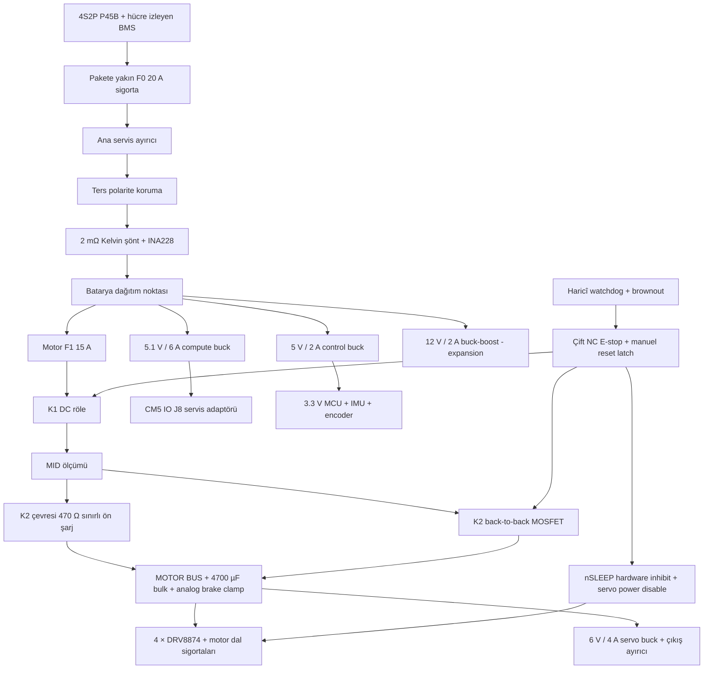

# UGV-01 — Elektrik, güç ve haberleşme ön mimarisi

> **A2 kaydı.** A3 Lite (≤10.000 TL, DD65–DD67) bu kartları ve pinleri kullanmaz; güncel elektronik: [Lite elektronik](lite_electronics_A3.md).

Rev A1 / 2026-09-23 / PHASE 0–1 mimarisi + PH5 pin ön incelemesi. Bu belge tasarım girdisidir; şematik, doğrulanmış PCB veya üretim izni değildir. Gerçek parça toleransları, kablo demeti ve sıcaklık testleri tamamlanmadan akım/gerilim sınırları kesinleştirilemez. Kaynak kimlikleri [electrical_sources.md](electrical_sources.md) içinde tanımlıdır.

## 1. Karar özeti

| Konu | İlk tercih | Gerekçe / kapanacak konu |
|---|---|---|
| MCU | STM32G474VET6, LQFP100 | Dört encoder timer'ı ve iki gelişmiş timerdan sekiz motor PWM kanalı; USB ve CAN birlikte kullanılabilir. Pin ön tahsisi aşağıda. |
| Motor | 4 × Pololu 4754, 70:1, 12 V encoder'lı 37D | 8 kg toplam kütlede V1 hız sınırı 0.8 m/s; tork hesabı drivetrain belgesinde. |
| Sürücü | 4 × DRV8874PWPR | Sabit donanımsal akım sınırlama + akım telemetrisi; 6 A katalog tepe değeri sürekli akım değildir. |
| Batarya | 4S2P Molicel P45B, BMS'li profesyonel paket | 14.4 V nominal, 16.8 V dolu, 9 Ah / 129.6 Wh tipik; BMS ve şarj cihazı MPN'si açık. |
| Motor beslemesi | Sigortalı, iki ayırma elemanından geçen ham batarya hattı | Ağır 120 W motor regülatörü gerekmez; aşağıdaki PWM, akım ve rejenerasyon önlemleri zorunlu. |
| Compute | CM5 8 GB eMMC + resmî CM5 IO Board | Prototip özel carrier'a bağlı değil; kart 160 × 90 mm. |
| Compute besleme | Ayrı 5.1 V / 6 A tasarım hattı | İlk IC adayı LM61495; 36 V giriş sınıfı transient payı sağlar. Kartın termal kapasitesi ayrıca doğrulanır. |
| Kontrol bağlantısı | Classical CAN, 500 kbit/s, 11-bit ID | CM5'te yerel CAN denetleyicisi yok; ilk prototip USB–CAN, carrier'da SPI CAN denetleyicisi. |
| E-stop | NC fiziksel devre + K1 DC röle + K2 sırt sırta MOSFET | Motor ve servo enerjisi kesilir; MCU, CM5 ve tanılama açık kalır. K1 seçimi ve DC motor yükü kesme kanıtı [açıktır](k1_relay_selection.md). |

Gövde içinde bölgeler: **BATTERY → MOTOR POWER → CONTROL → COMPUTE → SENSOR / COMMUNICATION**. Bunlar ayrı PCB toprak adaları anlamına gelmez; kablo dönüşleri ve fiziksel yerleşim ayrılır.

## 2. Güç akışı

K1 ve K2 birer bağımsız kesme yoludur; tek MOSFET ters akım yolu nedeniyle yeterli kabul edilmez. K1 enerjisizken açık DC kontak, K2 enerjisizken kapalı gate ile iletimsizdir. E-stop bobin/gate izin zincirini MCU'dan bağımsız keser. Logic beslemesi kesilse de ayırıcılar kapanamaz. Reset fiziksel yeniden kurma ve ardından ayrı ARM komutu gerektirir. K1/K2 arasındaki ve sonrasındaki gerilim ölçülerek her yolun ayrıldığı başlangıçta tek tek sınanır. [K2 denetleyici/FET seçimi](k2_separator_selection.md) koşullu aday ve ısıl hesap düzeyindedir. Bu kavram **SIL/PL sertifikası taşımaz**; kontaktör/röle seçimi, kontak kaynaması ve iki kanal ortak neden arızası analizi PHASE 6 çıkış koşuludur.

K1 bobini ham 4S'e bağlanmaz. Ön taramada [5 V/1 W TE T9AS1D17-5](k1_relay_selection.md) paketleme ve güç adayıdır; DC **rezistif** katalog değeri, K2 kısa kalınca motor yükü kesme kanıtı değildir. 12 V bobinli otomotiv alternatifinin 10–16 V çalışma aralığı da 16,8 V tam dolu paketten doğrudan beslemeye izin vermez. Kesin röle MPN'si, 16,8 V DC motor yükü, sürücü-bobin koruma ve kaynaklı kontak tanısı PH6 kapısıdır.

4700 µF bulk K2 sonrasındadır: K1 boş bulk'a doğrudan kapanmaz. K2 kısa/ön şarj kısa ile K1 inrush yaratılmasını önlemek için K1 kapatılmadan iki ayırıcının akım sınırlı tanısı, ardından K1→K2 çevresi 470 Ω ön şarj→K2 sırası gerekir. Test kaynağı, MID/ACT boşaltma, eşikler ve fault geçişleri [ayrı işlev tasarımında](precharge_and_separator_diagnostics.md) hesaplanmıştır. 24.09.2026'da bu devre, çift NC/watchdog izin zinciriyle birlikte [kısmi PWR KiCad sayfalarına](pwr_safety_path.md) çizildi (birleşik ERC 0 hata); K1 MPN, dump clamp, PCB ve fiziksel T01/T13 kanıtı olmadığından hâlâ **PH6/P0 kapısıdır**. Önceki “giriş precharge” ifadesi bu bulk için yeterli değildi.

## 3. Batarya, şarj ve servis

- P45B üretici tipik kapasitesi 4.5 Ah; 4S2P = 9 Ah, `4 × 3.6 × 2 × 4.5 = 129.6 Wh`. 4.3 Ah hücre minimumundan paket minimum hesabı 123.84 Wh. %80 kullanılabilir enerji varsayımı tipik kapasite için 103.68 Wh'dir; yaşlanma ve soğuk ayrıca azaltır. [E08]
- V1 paket, aynı üretim lotu eşleşmiş hücreler, hücre ayırıcıları, izolasyon pulları, nokta kaynaklı bağlantılar, NTC'ler, hücre bazlı UV/OV, kısa devre/akım kesme ve balans içeren **belgeli ticari BMS ile paket üreticisine** yaptırılır. Hücreye doğrudan havya veya gevşek yaylı yuva tasarımı yoktur. UGV-PWR-01 bir BMS değildir.
- Paket hedefi: ≥20 A sürekli deşarj kapasitesi olan BMS ve iletkenler; yazılım olağan çalışma akımını çok daha düşük tutar. BMS'nin sıcaklık sınırları, şarj/deşarj portları, rejeneratif akım davranışı, arıza latçi ve hücre telemetrisi tedarikte zorunlu doğrulanır. Yalnız paket voltajı bir zayıf hücreyi koruyamaz.
- 16.8 V CC/CV **4S Li-ion uyumlu**, bağımsız belgeli şarj cihazı; ilk şarj akımı 2 A, şarj sırasında sürüş kilitli. Şarj sıcaklığı projenin daha dar 5–40 °C aralığında başlatılır. Pack tedarikçisi sınırları daha darsa onlar uygulanır.
- Şarj portu batarya güç portundan farklı anahtarlanmış tipte; BMS şarj yoluna gider. Servis konnektörü kısa devreye karşı kapaklı. Şarj portu robotu veya motor bus'ı geriye besleyemez. Robot üzerinde şarj devresi ilk PCB kapsamına alınmaz.
- Ön eşikler: herhangi hücre <3.4 V / 5 s → güç azalt; <3.2 V / 1 s → kontrollü duruş ve CM5 kapanış isteği; <3.0 V / 10 ms → aktüatör kesme. Pack karşılıkları sadece dengeli durumda 13.6 / 12.8 / 12.0 V'dir. Ölçüm sıklığı/BMS iletişimi bu eşikleri karşılamıyorsa donanımsal BMS son korumadır; testlerde muhafazakâr paket UV eşikleri de kullanılır. Kapanış için enerji rezervi testle belirlenir; BMS kesmesini normal kapanış yöntemi olarak kullanma.
- SoC gösterimi coulomb counting + dinlenmiş açık devre voltajı + ölçülmüş kapasite ile yapılır. Yük altındaki voltajdan doğrusal yüzde türetilmez. INA228 ile toplanan enerji BMS hücre gözetiminin yerini tutmaz.

## 4. Motor ve sürücü sınırları

4754 için 12 V'da yüksüz akım 0.2 A, stall akımı 5.5 A; dört motor stall toplamı 22 A'dir. Tahmini soğuk sargı direnci `R ≈ 12/5.5 = 2.18 Ω`. Ham 16.8 V bağlanırsa hareketsiz tepe `16.8/2.18 = 7.7 A/motor`, toplam 30.8 A'ya çıkabilir. Bunlar ölçüm değil nominal veriden çıkarımdır. [E03]

Bu nedenle aşağıdaki katmanlar birlikte uygulanır:

DRV8874 **PMODE=High PWM modu** kullanılır. TI veri sayfasında PH/EN modunda `EN=0` iki çıkışı Low yapıp **brake** uygular; tasarımın nötr/coast şartı için bu uygun değildir. PWM modunda `IN1=0, IN2=0` iki çıkışı Hi-Z yapar. Her motor iki timer kanalını kullanır: ileri yönde yalnız `IN1` PWM, geri yönde yalnız `IN2` PWM; nötrde ikisi de 0. Yön değişiminde önce iki giriş 0 yapılır, en az bir PWM periyodu nötr doğrulandıktan sonra karşı kanal açılır. İki timerın senkronizasyonu, preload/update, break polaritesi ve motor akımı PHASE 5/8'de kanıtlanır. `IN1=IN2=1` düşük taraf frenlemesidir ve V1 hareket politikası bunu komut olarak kullanmaz. nSLEEP donanım izin hattı reset/arıza/E-stop'ta Low kalır. [E04]

1. Hız kontrolü 1 kHz, PWM 20 kHz başlangıç hedefi. `|duty| ≤ min(1, 12/Vmotor_bus)`; 16.8 V'da %71.4, 14.4 V'da %83.3. Akım geçişi/back-EMF/diode drop nedeniyle bu ortalama gerilim yaklaşımı tek başına motor koruması değildir. Gerilim ADC geçersizse sürüş kapanır.
2. Termal tasarım hedefi **1.3 A RMS/motor sürekli**. Başlangıç kısa akım isteği **2.5 A, en çok 250 ms**; tekrarı I²t birikimi ve soğuma ile sınırlandırılır. Encoder hızı sıfıra yakın + yüksek akım 300 ms → blokaj latçi. Yük altında kesintisiz yerinde dönüş V1'de doğrulanmadan serbest bırakılmaz.
3. MCU'dan bağımsız DRV8874 current regulation. Sabit referans hedefi yaklaşık 2.7 A; üretim toleransları ve blanking overshoot dahil **3.0 A üst sınır tasarım hedefi**. Bu sayının ölçülmüş sınır olduğu iddia edilmez.
4. `R_IPROPI=2.00 kΩ`, `V_REF=2.43 V`, tablo kazancı `450 µA/A` ile nominal `I_trip = 2.43/(2000×0.000450)=2.70 A`. ±5.5% kazanç, toplam ±1% referans ve ±1% direnç varsayımı ile statik üst sınır yaklaşık `2.7×1.01/(.945×.99)=2.915 A`; dinamik overshoot marjı ~85 mA'dır ve yetersiz çıkarsa referans düşürülür. Veri sayfası örneğindeki 455 µA/A yerine elektrik tablosundaki 450 kullanılmıştır. [E04]
5. nFAULT OCP ve thermal shutdown **motorun 1.3 A sürekli limiti değildir**. MCU ADC örnekleri PWM on/decay durumuna senkronlanır; IPROPI bütün PWM çevriminde ideal bipolar akım sensörü değildir. RMS/I²t kestirimi akım probuyla kalibre edilir, kalibrasyon kapanmadan 1.3 A garantisi verilmez.

İlk köprü sıcak direnç bütçesi `R_HS+LS=0.35 Ω` (tasarım varsayımı, 25 °C tipik toplam 0.2 Ω). İletim kaybı `I_RMS²R`: 1.3 A'da 0.592 W/kanal; 2.5 A'da 2.188 W/kanal; dört kanalda 2.37 W sürekli / 8.75 W kısa süre. Switching ve gate/charge-pump için ilk sürekli bütçe ayrıca 0.10 W/kanal; toplam ~2.77 W. [E04] 40–60 °C/W gerçek PCB termal direnci varsayımı ve 50 °C kart çevresinde `Tj≈78–92 °C` çıkar; dört sürücü birbirini ısıtır. Bu sıcaklık **termal tasarım hedefidir**, garantili veri değildir.

Motor driver termal pad, 2 oz dış katman, her kanala ayrılmış bakır alan ve termal via gerekir. Termal kamerayla board sıcaklığı tek başına junction ölçümü sayılamaz. NTC'ler sürücülere yakın; motor gövdesi NTC'leri kablo demetine alınır. Sürücü paketi ve termal model doğrulanmadan yüksek akımlı yük testi yapılmaz. Hedefler: motor gövdesi 60 °C altında olağan çalışma; 60 °C derate, 70 °C fault; PCB yerel 70 °C derate, 85 °C fault; hücre 45 °C derate, 55 °C stop — üretici daha düşük bir sınır verirse o uygulanır.

## 5. Rejenerasyon ve ayırma sonrası enerji

Ters polarite koruması veya BMS rejenerasyon akımını engelleyebilir. Batarya doluyken enerjiyi bataryaya geri basmak normal kontrol stratejisi değildir. K1/K2 açılınca da motor endüktansı ve mekanik hareket motor tarafındaki bus'ı yükseltebilir. **TVS tek başına fren enerjisini tüketme elemanı değildir.**

- 8 kg, 0.8 m/s için yalnız ötelenme enerjisi `0.5mv²=2.56 J`.
- 15° eğimde 0.5 m ileri hareketin potansiyel enerji katkısı `mgs sinθ = 10.16 J`; toplam 12.72 J. Motor/teker dönme enerjisi ve ölçüm payı ile ilk tek duruş gereksinimi **en az 20 J**. Bu 0.5 m bir duruş garantisi değildir.
- 4700 µF bulk'un 16.8→17.8 V depolayacağı fark yalnız `0.5C(17.8²−16.8²)=0.081 J`. Bulk yalnız transient/ripple içindir.
- Motor tarafına, kendi bus'ından beslenen MCU'dan bağımsız comparator + FET + chassis resistor clamp; ön açılma 17.8 V, ön bağımsız OV latch 18.5 V. Histerezis ve tüm toleranslar PHASE 6'da hesaplanır. Clamp E-stop ile kapatılmaz.
- Yaklaşık 10 A olası dört motor regen darbesi için `R≤17.8/10=1.78 Ω`. İlk aday **1.5 Ω**, 17.8 V'da 11.9 A / 211 W anlık. Parça, en az 20 J ilgili darbe süresi/tekrarı için üretici eğrisiyle doğrulanmalı; başlangıç yerleşim rezervi şasiye bağlanan 100 W sınıfı alüminyum direnç. Üzerindeki “100 W” tek başına 20 J darbe kanıtı değildir. [E17]
- Clamp FET'i short olursa direnç paketten güç çekebilir: bağımsız direnç sıcaklık izleme, termal ayırıcı ve latçli K1/K2 açma; open olursa OV latçi + TVS son transient koruması. Güç TVS standoff'u tam dolu paketten büyük, gerçek clamp'i bütün etkilenen yarıiletkenlerin absolute maximum'undan küçük seçilir. MPN kesinleşmeden TVS “koruyor” kabul edilmez. 35 V/50 V kondansatör sınıfı değerlendirilecek.
- E-stop **coast** davranışı: tekerlekler serbest dönebilir; eğimde park/fail-safe tutma yoktur. Testte tether/takoz gerekir. Eğimde sahipsiz duruş istenirse mekanik normalde kapalı fren yeni gereksinim olur.

## 6. Elektrik güç bütçesi

Üç farklı değer karıştırılmamalıdır: kullanım ortalaması, sürekli termal zarf ve kısa transient. Aşağıdaki güçler tahmindir; yük profilini kayıtla doğrula. DC/DC verimi ilk hesapta %90; motor hattı ham batarya, motor uç gücü kullanılır. Compute satırı kamera/USB yardımcı satırlarını **içermez**; 5.1 V hattının toplamı ayrıca sınırlandırılır.

| Tüketici | Tipik görev, çıkış W | Ağır görev, çıkış W | Arayüz rezervi |
|---|---:|---:|---|
| 4 motor, motor uçları | 33.6 (4×12×0.7 A) | 62.4 (4×12×1.3 A) | 120 W / 250 ms |
| Driver iletim kaybı | 0.69 | 2.37 | 8.75 W / kısa |
| CM5 compute | 15.0 | 25.5 | 5.1 V hattı toplam 6 A |
| MCU + encoder + IMU + CAN + 2×PCA9615 | 3.0 | 3.0 | ayrı 5 V / 2 A; PCA9615 iki uç için ≤1 W zarfı içinde ayrılır |
| K1 bobini, 5 V aday; yalnız ARMED/DRIVING | 1.0 | 1.0 | 5 V kontrolde ek 0,20 A; MPN henüz serbest değil |
| İki CSI göz kamerası (A2) | 2.0 | 2.0 | Compute hattından; beklenen ≈0,6 W, önceki 2 W UVC tahsisi korunur |
| Fanlar | 2.0 | 2.0 | 5 V control veya compute, bağlantıda atanacak |
| Dört servo (A2: pan, tilt, omuz, pençe) | 3.0 | 8.0 | MCU kartında ACT_BUS beslemeli 6 V / 4 A = 24 W üst zarf; [A2 elektronik](a2_electronics.md) |
| Işık şeridi + 2 ToF (A2) | 0.6 | 0.6 | Şerit 5V_CONTROL, firmware tavanı ≤0,5 W; ToF compute hattından ≈0,1 W |
| 12 V ek yük | 0 | 0 | 12 V / 2 A = 24 W, V1'de DNP/kapalı |

Batarya güçleri, K1 bobini enerjiliyken ve **A2 dört servo, ışık şeridi ve ToF dâhilken**: tipik `33.6+0.686+(15+3+1+2+2+3+0.6)/.9 ≈ 63.84 W`; ağır `62.4+2.366+(25.5+3+1+2+2+8+0.6)/.9 ≈ 111.54 W`. Switching kaybı, BMS/şönt ve kablolar için aynı ≈%2 payla muhafazakâr üst görev bütçesi **65,0 W tipik / 113,8 W ağır** kullanılır (`config/vehicle.json` `duty_power_*_w`); ölçülmüş tüketim değildir. A1 değerleri 62,06/105,32 W → 63,2/107,4 W idi. K1 MPN'si değişirse bu satır yenilenir. NXP tablosundaki sonlandırma süren iki kanal Low akımı için her PCA9615'in yerel 5 V rayında 0,1 A (~0,5 W) payı vardır; toplam ≤1 W, 3 W kontrol satırının içinde ayrılmış **tasarım varsayımıdır**, diğer kontrol tüketicileriyle gerçek ölçümde doğrulanır. 5 V/2 A kontrol rayında 3 W elektronik +1 W röle +0,5 W ışık şeridi, 5,5 W kuramsal rezerv bırakır. Compute 25.5 W+kamera2 W+compute fanı2 W=29.5 W, 30.6 W rail sınırı içinde; ek USB aygıt bağlanırsa bu bütçeden düşülür.

Tipik usable 103.68 Wh ile planlama süresi **1,60 saat / 0,91 saat**. Minimum hücre kapasitesiyle %80 usable 99.07 Wh → **1,52 / 0,87 saat**. Ana kabul hesabı (minimum kapasite, %80 kullanım, %85 yaşlanma, 84,21 Wh): **1,30 / 0,74 saat**; 60 dakika hedefi yalnız tipik profilde desteklenir. Soğuk, yaşlanma, Wi-Fi trafiği ve terrain değişimi bu süreleri kısaltabilir; kullanıcıya garanti verilmez.

Tüm arayüzleri aynı anda transient sınırına koyan üst zarf: motorlar120 W + driver8.75 W + (compute30.6 + control10 + servo24 + aux24)/.9 = **227.2 W**; 12.4 V'da **18.3 A**. Röle 1 W, 10 W kontrol kapasitesinin **içindedir**; bu transient hesabına ikinci kez eklenmez. Tasarım main 20 A sigorta bu darbe için adaydır, sürekli genişleme bütçesi değildir. V1 görev yazılımı sürekli batarya gücünü 150 W altında ve motor RMS'lerini 1.3 A altında tutar. 12 V expansion takıldığında toplam bütçe yeniden gözden geçirilir.

Regülatörler: compute LM61495 (36 V giriş, IC 10 A; kart hedefi 6 A); control için bağımsız buck, servo için 6 V / 4 A buck, 12 V auxiliary için TPS55288 buck-boost aday. 4S batarya düşükken buck üzerinden kesin 12 V garanti edilemez. TPS55288 “16 A” değeri 12 V çıkışa sürekli 16 A sağlama vaadi değildir. Bütün bobinlerde ripple dahil tepe akım/doyum, giriş kondansatörü ripple, minimum on/off time ve sıcaklık hesabı PHASE 6'ya aittir. [E09–E11]

## 7. Sigorta, konnektör ve kablo ön boyutlandırması

| Devre | İlk sigorta adayı | Bakır tel başlangıcı | Konnektör / koşul |
|---|---:|---|---|
| Batarya → PWR | 20 A DC ana, pakete yakın | AWG12, kısa çift | AMASS XT60H-F/M + özel tutucu/çekme önleme; 30 A nominal veri, kilit mekanik tasarımla sağlanır |
| PWR → MCU motor + sürekli kontrol | 15 A motor + 2 A kontrol | J-PWR: AWG12 ACT ve 2×AWG12 ortak GND; AWG16 5 V; her damar ≤0,4 m | Molex Mega-Fit 4 pin aday; her GND tek başına fault yükü için incelenir, gerçek termal derating gerekli |
| Her motor | 3 A gecikmeli aday | AWG18, loop ≤1 m | Molex Mini-Fit Jr 2 konum aday; kesin header/terminal MPN ve tel aralığı dondurulacak |
| Compute buck girişi | 5 A | AWG18 | Kilitli 2 pin; compute çıkışı AWG16, kısa |
| Control buck girişi | 2 A | AWG22 | Kilitli 2 pin |
| Servo buck girişi | 3 A gecikmeli aday | AWG20 | Servo çıkışı en az AWG18 ortak besleme; aktüatör kesme yolunda |
| 12 V AUX girişi | 3 A | AWG20 | Kilitli, polarity-keyed; yalnız onaylı modüle |
| Encoder / sensör | 100 mA/encoder dal koruması | AWG26 signal | JST GH 1.25 mm; motor gücü bu konnektöre verilmez |

Tel çapları ampacity sertifikası değildir. İzolasyon sıcaklığı, bundling, titreşim, crimp ve dar kablo kanalı sıcaklığı incelenir. [E14–E16] AWG12 yaklaşık 5.21 mΩ/m, 0.6 m loop / 20 A → 0.063 V ve 1.25 W; AWG18 yaklaşık20.95 mΩ/m, 1 m / 3 A → 0.063 V ve0.189 W. Sıcak bakırda direnci ayrıca artır. Sigorta **kabloyu/kısa devreyi** korur; driver akım regülasyonu motoru, I²t gözetimi termal yükü korur. 3 A fuse 2.5 A darbesinde açmayabilir; exact üretici zaman-akım/I²t eğrisi, BMS kısa devre davranışı ve DC kesme kapasitesiyle seçicilik PHASE 6 kapanış koşuludur.

Kablo isimleri: `PWR-BAT`, `PWR-MOTOR`, `PWR-CM5`, `M-FL/FR/RL/RR`, `ENC-FL/FR/RL/RR`, `CAN-H/L/REF`, `ESTOP-A/B`, `SENS-MAST`. Her iki uçta etiket, servis payı, strain relief, pin-1 işareti ve ters takılamayan anahtar bulunur. Motor çiftleri bükümlü; CAN kendi bükümlü çifti; kamera flex'i motor bus/indüktörlerden uzak. Kablo kanalları ön CAD'de bağımsız koridor olarak ayrılır. Hiçbir telemetri/shield bağlantısı kesilmiş aktüatör enerjisini başka raydan geri besleyemez.

PWR↔MCU bağlantılarının J-PWR/J-SIG pin sırası, aday kilitli konnektör MPN'leri, süreklilik ve hat kopuğu davranışı için tek referans [arayüz sözleşmesi](pwr_mcu_interface.md). Ayrı motor/kontrol GND demetinin hesaplanan dolaşım akımı nedeniyle tek güç konnektöründe iki yüksek akım dönüşüne geçildi. Başka bir kablo/shield üzerinden paralel dönüş ve referans kayması hâlâ ölçülecek EMI/ground konusudur.

Harici J-SIG artık 12 pin: INA228 şönt yanında PWR üzerinde kalır, PA8/PA9 tek uçlu I²C yalnız kart içinde çalışır ve iki PCA9615 arasında SCL/SDA için iki diferansiyel bükümlü çift taşınır. PWR durum ve izin hatları ayrıca güçsüz MCU'da geri beslemeyi önleyen alıcı katı ister. [PCA9615 referans devresi](../electronics/interconnect/differential_i2c_reference.kicad_sch) kart tarafı 3,3 V / kablo tarafı 5 V, iki uçta sonlandırma-bias ve yerel `PGOOD` ile `EN` gösterir. Yerel ray/`PGOOD` üretimi, ayrık güç sırası ve gerçek kart arayüzü PH5/6 şematik girdisidir; referans ERC'si bunları doğrulamaz.

## 8. PCB ve topraklama stratejisi

Ön stackup PWR ve MCU: 4 katman / 1.6 mm, dış katman 70 µm (2 oz), iç 35 µm; L1 bileşen+kısa güç döngüleri, L2 kesintisiz GND, L3 güç adaları/yavaş sinyaller, L4 sinyal+GND. Compute carrier hedefi 6 katman ve kontrollü empedans; kesin dielectric kalınlıkları PCB üreticisiyle seçilir. MIPI/USB3/PCIe için yalnız “6 katman” yeterlilik kanıtı değildir.

- PWR dağıtım noktasına motor ve compute beslemesi ayrı çift olarak döner. Motor yüksek akımı MCU/IMU altından dolaşmaz.
- MCU kartında “analog/dijital” diye rastgele kesilmiş ground plane yok; yerleşimle dirty/quiet bölge ayrılır. Akım döngüsü sinyal dönüş yolunu kesmez. VDDA lokal filtre/decoupling; ADC RC ve Kelvin şönt uçları anahtarlama düğümünden uzak.
- Sürücü motor+ ve return polygon'u birbirine yakın; her VM'nin ceramic/bulk decoupling'i yerel. Motor uçlarına kondansatör/snubber yeri bırakılır; değerler EMI ve oscilloscope ölçümüyle seçilir.
- Şasi güç dönüş iletkeni değildir. Metal alt plaka için kontrollü tek chassis bond ve EMI için şaseye kapasitif seçenek, test sonucuna göre; rastgele çok noktadan USB/GND loop'u kurma. Motor gövde EMI kapasitörleri seçilirse aynı stratejiye dahil edilir.
- İlk DC direnç taraması, 20 °C, 70 µm tek dış katman ve 50 mm yol: main12 mm genişlik → 1.03 mΩ /20 A'da0.41 W; motor trunk10 mm →1.23 mΩ /15 A'da0.28 W; motor dalı2 mm →6.16 mΩ /3 A'da0.055 W. `R=ρL/(wt)`, `ρ=0.017241 Ω mm²/m`. Bu değerler pad neckdown/via/konnektör direncini içermez; termal kabul değildir. IPC-2152 tabanlı gerçek stackup analizi ve kupon/yük testi yapılacaktır.
- Ana 20 A yollar için tek dar via yok. Katman geçişi gereksizse üst geniş polygon tutulur; gerekli geçişlerin via sayısı gerçek kaplama kalınlığı ve sıcaklıkla hesaplanır. GND plane'i bakır ısı yayıcı olarak kullanırken kısa devre creepage/clearance şartları korunur.
- Test noktaları: VBAT ön/son koruma, K1 sonrası, MOTOR_BUS, 5V_COMPUTE,5V_CONTROL,6V_SERVO,12V_AUX,3V3, her IPROPI,VREF, nFAULT,nSLEEP, watchdog WDI/WDO, ESTOP_A/B,CANH/L, SWD, reset, ADC referansı. Yük altında erişilebilen kısa devre riski yaratmayan prob açıklıkları.

## 9. MCU kaynak ve pin ön tahsisi

DS12288 Rev6 Tablo12/13 ve KiCad 10 `STM32G474V_B-C-E_Tx` LQFP100 sembolü ile **peripheral/pin uygunluğu** kontrol edildi. Atamaların makine tarafından denetlenen kaynağı [`config/mcu_pinmap.json`](../config/mcu_pinmap.json); sonuç ve açık kapılar [pin incelemesinde](mcu_pinmap_review.md). Bu bir CubeMX `.ioc` / tam elektrik pinout doğrulaması değildir; bütün power/VDDA/VREF, BOOT, crystal, GPIO akımı ve alternate-function ayarları şematikte ayrıca denetlenir. [E01,E02]

| İşlev | Kaynak | GPIO / AF |
|---|---|---|
| FL encoder | TIM2 CH1/2, 32-bit | PA15/PB3, AF1 |
| FR encoder | TIM3 CH1/2, 16-bit | PB4/PB5, AF2 |
| RL encoder | TIM4 CH1/2, 16-bit | PB6/PB7, AF2 |
| RR encoder | TIM5 CH1/2, 32-bit | PA0/PA1, AF2 |
| 4 × IN1 PWM | TIM8 CH1..4 | PC6/PC7/PC8/PC9, AF4 |
| 4 × IN2 PWM | TIM1 CH1..4 | PE9/PE11/PE13/PE14, AF2 |
| CAN | FDCAN1 RX/TX | PD0/PD1, AF9 |
| USB FS servis | USB_DM/DP | PA11/PA12, dedicated |
| SWD | SWDIO/SWCLK | PA13/PA14 |
| Debug UART | USART3 TX/RX | PC10/PC11, AF7 |
| IMU SPI | SPI1 SCK/MISO/MOSI | PA5/PA6/PA7, AF5 |
| IMU chip select / DRDY | GPIO | PA4 ve PE0 / PE1 ve PE2 aday |
| Akımlar | ADC DMA | PC0..PC3 analog rezerv |
| Timer break | TIM8 BKIN + TIM1 BKIN | PD2 AF4 + PE15 AF2; bağımsız nSLEEP zinciri ayrıca |
| Pan/tilt servo | TIM15 CH1/2, 50 Hz | PA2/PA3, AF9 |
| Omuz servo (A2) | TIM17 CH1, 50 Hz | PB9; AF CubeMX'te teyit |
| Pençe servo (A2) | TIM20 CH2, 50 Hz | PE3; AF CubeMX'te teyit |
| Servo rayı istek / akım (A2) | GPIO / ADC2_IN5 | PE8 / PC4 |
| Işık şeridi verisi (A2) | SPI2 MOSI, yalnız TX | PB15; SCK pini bağlanmaz, CubeMX teyidi açık |
| I²C ölçümler | I²C2 | PA8 SDA / PA9 SCL, AF4 |
| PWR izin/watchdog ve tanı | GPIO | PD8..PD15; tam net adları arayüz sözleşmesinde |
| Driver fault | GPIO | PE4..PE7 |

PA15/PB3/PB4 JTAG fonksiyonlarından ayrılır; **SWD kalır, SWO PB3 kullanılamaz**. CAN'i PA11/12'ye bağlamak USB ile çakışır; bu yüzden PD0/1 seçildi. Eski PB10/PB11 I²C2 adayı veri sayfasında yoktur ve çıkarılmıştır. PB8-BOOT0, I²C1 SCL yapılıp pull-up ile boot seviyesini belirsizleştirmemek için kullanılmaz. Encoder pinleri ADC gibi kullanılmaz. 16-bit sayaç farkları modulo çıkarılır; 1 kHz örnekte taşma belirsizliği olmayacak hız sınırı uygulanır.

Encoder beslemesi 5 V: 3.3 V doğrudan besleme üretici alt sınırının dışında kalabilir. A/B çıkışları 3.3 V'a 5 V toleranslı Schmitt buffer (SN74LVC2G17 sınıfı, kesin MPN doğrulanacak) ile çevrilir; MCU pad toleransına güvenilmez. Başlangıç seri direnç/RC ve timer digital-filter ayarı gerçek osiloskopla 11.2 kcount/s/motor üstündeki margin'de doğrulanır. Encoder yönü/kablo çaprazı testte izlenir.

IMU aday BMI088, SPI, iki chip-select ve data-ready; güçlü motor titreşimine yakın olmak zorunda değildir. Board CG civarındaki sakin bölgeye konur; sensör eksenleri CAD/URDF ile aynı olur. Motor mıknatısları yüzünden onboard magnetometreye yaw gerçeği gibi güvenilmez. BMI088 canlı tedarik sayfasındaki stok bilgileri boş/0 göründü; gerçek tedarik onayı alınmadan alternatif footprint uyumlu sayılmaz. [E13]

## 10. CAN ve alternatifler

CM5 ⇄ USB ⇄ **PEAK PCAN-USB FD IPEH-004022** ⇄ bükümlü CANH/L + CAN reference ⇄ TCAN1042HV-Q1 ⇄ STM32 FDCAN1. Adaptör kendi izole CAN tarafına sahiptir; CAN reference MCU tarafına bağlanır, izolasyon bariyeri USB ground ile kısa devre edilmez. USB konnektörü için mekanik kelepçe gerekir. Üretici Linux `peak_usb` desteği mevcut; yeni adaptör revizyonu kernel≥6.x gerektirebildiğinden seçilen Ubuntu/CM5 imajında `can0` bring-up zorunlu. [E05,E06,E12]

Custom carrier aşamasında CM5 SPI ⇄ **MCP2518FD + transceiver** ve IRQ hattı; SocketCAN sürücüsü/Device Tree, osilatör frekansı ve IRQ gecikmesi doğrulanır. CAN transceiver'ı tek başına SPI/CAN dönüştürücü değildir. Aynı uygulama `can0` arayüzü üzerinden iki taşıyıcıyı kullanır. [E07]

| Seçenek | Değerlendirme |
|---|---|
| CAN | Diferansiyel, arbitration, hata sayacı/bus-off, kabloya yeni düşük bant genişlikli düğüm ekleme; Linux gerçek zamanlı olmasa da MCU yerel 1 kHz çevrimi korur. CRC, komut tazeliği veya yetkilendirmeyi tek başına sağlamaz. |
| USB doğrudan STM32 | Kısa mesafede hızlı ve ucuz; debug/firmware için tutulur. USB reconnect, host scheduling ve kilitsiz konnektör riskleri; çoklu modül omurgası olarak seçilmedi. |
| UART/RS-485 | UART TTL uzun/elektriksel gürültülü kablo için zayıf; RS-485 fiziksel katmanı iyidir ancak bus arbitration/protocol/fault yönetimini kendimiz yazmak gerekir. |
| Ethernet | Video/CM5 ağında uygun; STM32G474'te Ethernet MAC yok, ek silikon/stack dört motor için gereksiz. |
| SPI/I²C | PCB içi sensör ve carrier CAN-controller bağlantısı; araç içi modüler motor kontrol omurgası için seçilmedi. |

CAN kablo trunk'u yaklaşık1 m altında; iki uçta120 Ω, unpowered CANH–CANL toplam yaklaşık60 Ω; ara düğümler terminasyonsuz, kısa stub hedefi≤0.10 m. İlk bitrate500 kbit/s; board/carrier FD-capable olsa da V1 protokolü Classical CAN. Konektör kilitli, ESD ve transceiver çevresi üretici referansına göre. [E12]

CAN ID/hız ve bant hesabı için tek referans [communication_architecture.md](communication_architecture.md).360 periyodik frame/s,160bit/frame muhafazakâr bütçeyle%11,52;10fault/s dahil%11,84. Sürekli kullanım üst hedefi%30;heartbeat50Hz ve100ms timeout. Kamera CAN'den geçmez.

Komutta seq, sürüm, arm/deadman ve hız hedefleri bulunur; sürüm/DLC/aralık/seq/state doğrulanır. 100 ms içinde **yeni ve geçerli hareket komutu** gelmezse MCU aktüatör iznini kaldırır; heartbeat gelmesi eski komutu canlı tutmaz. Bus-off veya USB adapter disconnect latçli FAULT, yeniden bağlantı auto-arm yapmaz. Browser/gamepad kaybını CM5 yenilenmeyen lease üzerinden iletir; websocket açık kalması hareket izni değildir. Tam DBC/byte packing PHASE8 öncesi oluşturulur.

## 11. Donanım güvenliği ve açık seçimler

Haricî watchdog ön aday TPS3431SDRBR: WDI ancak ana kontrol/safety turu başarılı tamamlanınca beslenir, timer IRQ'da körlemesine beslenmez. Önceki 330 pF CWD hesabı yaklaşık88,5 ms üst tahminle ≤100 ms hedefe kâğıt üzerinde yakın kalıyordu; [yeniden seçilen 100 pF C0G CWD](watchdog_design.md) için TI veri sayfası `t≈77,4×C(nF)+55 ms` ile tipik62,74 ms, +%5 kapasite ve ×1,095 IC üst çarpanıyla yaklaşık69,12 ms verir. Yalnız watchdog trip için **100 ms üst sınır hedefi**; ardından röle/gate kaynak ayırması≤50 ms, toplam≤150 ms için kart ölçümü gerekir. EN/SET1 MCU kontrolüne verilmez; WDO/ENOUT tek başına güçsüzken güvenli izin sayılmaz, ayrı PGOOD şarttır. WDO reset pulse bitince aktüatörler kendiliğinden açılmaz; haricî latch manuel reset ister. MCU IWDG ek ikinci teşhis/yeniden başlatma katmanıdır. [E18]

Şematik başlamadan kapanacaklar: BMS/hücre telemetrisi, DC röle+FET sürücüsü MPN, true DC kesme kapasitesi ve iki ayırıcı feedback test devresi, brake resistor darbe eğrisi/FET SOA, TVS toleransları, exact fuse family/I²t, konnektör/contact MPN, servo stall akımı, motor gerçek akım dalga şekli, compute bootloader J8 güç konfigürasyonu, termal fan/airflow. Bunlar sessizce ideal varsayılmamıştır.

Üretime çıkış: KiCad ERC/DRC; pin/polarity bağımsız review; stackup onayı; BOM lifecycle/tedarik kontrolü; connector mating table; load-step/short/brownout/reverse-input testleri; E-stop tek hata testi; motor EMI altında CM5 reset/encoder hata testi; assembly drawing, Gerber/drill/BOM/PnP ve test fikstürü. Bu revizyonda bunların tamamlandığı iddia edilmez.

Enerji süresi A0 düzeltmesi: yukarıdaki1,67/0,98 saat yeni tipik hücre ve yalnız%80 kullanım hesabıdır. Ana kabul raporu minimum hücre kapasitesi ve%85 yaşlanmayı da içerir:84,2112Wh kullanılabilir,62W profilde1,358saat,106W profilde0,794saat.60dakika hedef yalnız tanımlı62W profile aittir.
