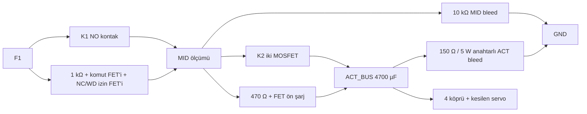

# K1/K2 ön şarj ve iki ayrı kesici tanısı — PH6 işlev tasarımı

23.09.2026 · **Şematik ve donanım onayı değildir.** Mevcut güç yolu `F1 → K1 → MID → K2 → ACT_BUS` şeklindedir; en az 4700 µF bulk `ACT_BUS` tarafındadır. Önceki “giriş precharge” ifadesi bu bulk'u K1/K2 kapanırken şarj etmez. K1'i boş 4700 µF'e doğrudan kapatmak kontak inrush'ını sadece kablo/ESR ile sınırlayacağı için kabul edilemez. 16,8 V'ta yalnız bu bulk enerjisi `½CV² = 0,663 J`; sürücü, servo regülatörü ve kablo kapasitansları gerçek toplam `C_ACT`'e eklenir. Düşük enerji, düşük **tepe akımı** anlamına gelmez. K1 kesin MPN'si ve temas kaynaklanma riski bu sıralamaya bağlıdır.

**Değerler tasarım başlangıcıdır.** 470 Ω ön şarjda `I0=16,8/470=35,7 mA`, `P0=16,8²/470=0,60 W`, `τ=RC=2,209 s`; 1 V kapanma farkına `t=τ ln(16,8/1)=6,23 s` ideal koşulda ulaşır. Ön şarj direnci ≥2 W ve ≥0,663 J/tek darbe için üretici eğrisiyle seçilir. Süre sınırı ve direnç sıcaklığı ölçülmeden timeout dondurulmaz. 150 Ω ACT boşaltma direnci 16,8 V'ta başlangıç `1,88 W`, `τ=0,705 s`; 1 V'a ideal olarak `1,99 s` sürer. Direnç 5 W ve sıcaklık/takılı kalma deneyi ile onaylanır. Sürüşte bleed kapalıdır. 10 kΩ MID bleed yaklaşık 28 mW harcar.

Test kaynağı `F1` sonrası/`K1` öncesinden `MID`'e 1 kΩ üzerinden en çok 16,8 mA verir; **K1'i kapatmaz**. Test yolunda iki seri, varsayılan kapalı anahtar vardır: biri yalnız ön test komutuyla, diğeri çift NC + haricî watchdog güvenlik izniyle açılır. Yalnız FET gate'ini NC ile Low yapmak kısa kalmış FET'i ayıramayacağından yeterli değildir. İki anahtarın gate sürücüleri ve ortak nedenleri PH6 FMEA konusudur. MID 10 kΩ ile sağlıklı açık K2'de teorik `16,8×10/(1+10)=15,27 V` olur, ACT bleed açıkken ACT <1 V kalır. K2 veya ön şarj FET'i kısa ise ACT bleed yükü MID'e yansır: `10 kΩ || 150 Ω ≈ 147,8 Ω`, `VMID≈16,8×147,8/(1000+147,8)=2,16 V`, ACT de yaklaşık 2,16 V olur. Test direncinde yaklaşık 0,214 W sürekli güç çıkar; ≥1 W parça/derating ve test süresi gerekir.

**Tolerans ön taraması:** 1 kΩ/10 kΩ/150 Ω dirençlerin her birinde ±%5 ve kaynakta 12,4–16,8 V varsayılırsa, MID sağlıklı açık yolda **11,17–15,41 V**, K2/ön şarj kısa ve ACT bleed açıkken **1,46–2,36 V** olur. Varsayılan toplam ADC+kalibrasyon hatası ±0,3 V eklenirse iki aralık sırasıyla 10,87–15,71 V ve 1,16–2,66 V'tur; 8 V taslak ayırım eşiğine kâğıt üzerinde pay vardır. Bu hesap kaçak, motor sürücüsü giriş yükü, servo DC/DC giriş kapasitesi, sıcaklık katsayısı ve ölçümün enerjisiz ray davranışını **içermez**. `ACT<1 V` şartı ayrıca gerçek yükle kanıtlanır; 1 V eşik henüz release değildir.

4700 µF'ün +%20 ve 470 Ω'un +%5 toleransında, ideal 16,8→1 V ön şarj farkı yaklaşık **7,85 s**, 150 Ω ACT bleed ile 16,8→1 V boşalma yaklaşık **2,51 s** olur. Dolayısıyla önceki 2 s SELF_TEST zaman aşımı bu boşalmayı kapsamaz. İlk açılış SELF_TEST için ≤5 s, ayrı **ARMING** durumunda boşalma+ön test+ön şarj için toplam ≤15 s taslak bütçedir; bunlar donanım akımı, sıcaklık, kaçak ve ADC filtre gecikmesi ölçülmeden dondurulmaz. İzin/doğrulama penceresi boyunca CM5 komutu ve deadman tazeliği korunur; süre aşımı `FAULT` olur.

## ARM öncesi ve sürüş sırası

1. Fiziksel çift NC sağlıklı, yerel reset yapılmış, MCU watchdog taze, motor PWM `00`, nSLEEP Low ve servo çıkışı fiziksel inhibit durumunda olsun. K1/K2 ve ön şarj/test anahtarları **iletimsiz**; ACT bleed açılıp ACT <1 V olana dek beklenir. Hız/IMU hâlâ hareket gösteriyorsa test ertelenir; eğimde tekeri tutma garantisi yoktur.
2. Test akımı **yokken** MID yüksek kalırsa K1 kaynaklı veya alternatif besleme vardır: `FAULT`, ARM reddi. ACT yüksek kalırsa bleed/regen/başka geri besleme hatası: `FAULT`.
3. K1/K2 açıkken akımı sınırlı test kaynağı açılır. MID yükselip ACT düşük kalırsa K2 ve ön şarj bypass'ı açık adaydır. ACT de yükselirse K2 veya ön şarj anahtarı kısa: `FAULT`, K1 **kapanmaz**. MID yükselmezse test kaynağı/ölçüm/hat hatası: `FAULT`. Test kapatılır, MID'in bleeder üzerinden düşmesi doğrulanır.
4. K1 bobini açılır, K2 açık kalır; K1 yalnız küçük MID kapasitansını şarj eder. MID gerilimi bataryayı izlemiyorsa `FAULT`. ACT bleed kapanır; K2 çevresindeki 470 Ω ön şarj yolu açılır. ACT, belirlenmiş süre içinde MID'in ≤1 V altına yükselirse ön şarj yolu kapanır, sonra K2 açılır. Ön şarj timeout'u/ani yükselme/ısınma → K1/K2 aç, `FAULT`.
5. K2 gerilim düşümü ve `ACT_BUS` ancak bu noktada kabul edilir; sonrasında `PWR_ACT_EN` High ve servo çıkış izni verilir. CM5 komut oturumu/nötr/deadman ayrıca gerekir. Boşaltma/test/ön şarj istekleri MCU'dan gelse bile fiziksel E-stop ve haricî watchdog K1/K2/ön şarj/test izinlerini donanımda keser. `PWR_ACT_EN` ARMING boyunca Low kalır.

`PWR_K1_FB` ve `PWR_K2_FB` sadece “MID/ACT yüksek” kabloları olamaz; yukarıdaki **komut + üç gerilim + zaman** tanısının sonuçları olmalıdır. PWR üzerinde üç gerilimi ölçen ADC/karşılaştırıcı ve bağımsız test/ön şarj/bleed sürücü devresi 24.09.2026'da P0 aday olarak çizildi (aşağıdaki KiCad karşılığı); MPN, analog hata bütçesi ve ölçüm henüz kesinleşmedi. Mevcut J-SIG'de bu komutlar için ayrı pin yoktur. İlk arayüz adayı: PWR'de [TCA9534A](https://www.ti.com/lit/ds/symlink/tca9534a.pdf) I²C GPIO (power-up'da bütün pinler giriş) + [ADS1115](https://www.ti.com/lit/ds/symlink/ads1115.pdf) dört kanallı ADC; iki PCA9615 arasında mevcut diferansiyel I²C üzerinden MCU tarafından yönetilir. GPIO'nun reset giriş olması, MCU kilitlendiğinde son çıkışın High kalmasını **önlemez**: K1/K2/ön şarj/test sürücüleri ayrıca NC, haricî watchdog, ray-iyi ve uygun donanım kilidiyle AND edilir. ADC yalnız ARM ön testi/şarj sıralaması içindir; milisaniyelik E-stop veya OV kesmesine kullanılamaz. Her ölçüm girişi bölücü/filtre/koruma ister; ADS1115 veri sayfası analog pinde `GND−0,3 … VDD+0,3 V` sınırı koyar, özellikle ADC güçsüzken ham 4S bölücüsünün geri beslemesi çözülmelidir. PWR kartı `PWR_K1_FB`/`PWR_K2_FB` çıkışını ancak bu ölçüm/tanı sözleşmesine uygun gerçek devreyle üretebilir. Exact MPN, pin, bölücü, hatalı I²C recovery ve zamanlama PH6'da kapanır; bu satır kart şematiği değildir.

TCA9534A için ilk mantıksal tahsis: `P0=TEST_CMD`, `P1=PRECHARGE_CMD`, `P2=BLEED_CMD`, `P3=K1_CMD`, `P4=K2_CMD`, `P5=ACT_ENABLE_REQUEST`; 24.09.2026 şemasında `P6=K2_FLT` ve `P7=LATCH_OK` giriş olarak kullanıldı ([DD58](design_decisions.md)). Her komut çıkışında tüketici tarafında haricî 100 kΩ Low pulldown vardır. ARMING boyunca `P5=0`; PWR'deki `PWR_ACT_EN`, `P5` ile `SAFE_GATE` ve K1/K2 tanı penceresinin donanım onayını gerektirir. I²C işlemi hataya düşerse MCU hemen `MCU_RUN_REQ=0` yapar ve WDI'yi durdurur; expander'ın son High çıkışı güvenli kabul edilmez. `BLEED_CMD` yalnız hareket yokken ve aktüatör izni Low iken mümkündür. Bu pin tahsisi bağlantı planıdır; hardware latch, ADC netleri ve gerçek sürücü devresi çizilmediğinden üretim serbestliği vermez.

**Tek-hata sınırı:** K2 veya ön şarj FET'i kısa ise 3. adım K1'i kapatmaz; K1 kaynaklı ise 2. adım ARM'i reddeder. Test komut FET'i kısa kalırsa bağımsız NC/WD izin FET'i E-stop'ta kaynağı ayırır; NC/WD izin FET'i kısa kalırsa varsayılan kapalı komut FET'i ayırır. İki anahtarın aynı anda kısa kalması veya ortak gate arızası tek-hata iddiasına dahil edilmez ve ayrıca FMEA ister. 1 kΩ sınırlama tek başına “tork üretmez” kanıtı değildir. 2–15 s tanı/şarj gecikmesi **E-stop kapatma süresi** değildir; fault sırasında donanım kesme hedefi ≤150 ms bağımsız kalır.

PH6 kapanış kanıtı: K1/K2 ve FET MPN/SOA; 4700 µF gerçek C/ESR/tolerans; analog eşik ve ADC hata bütçesi; ACT/MID bleed ısısı; test akımının aktüatörde tork üretememesi; E-stop/WD her FET arızasında gate/besleme kesmesi; kayıtlı osiloskop izleri; T01/T13 K1-kaynaklı, K2-kısa, ön şarj-kısa/açık ve enerji geri besleme deneyleri. Bu olmadan `PWR_K1_FB`/`PWR_K2_FB` güvenlik kanıtı veya PCB release'i değildir.

## 24.09.2026 KiCad karşılığı

Bu sıra [aktüatör yolu](../electronics/ugv_pwr_01/actuator_path.kicad_sch), [güvenlik kapısı](../electronics/ugv_pwr_01/safety_gate.kicad_sch) ve [ARM I/O](../electronics/ugv_pwr_01/arming_io.kicad_sch) sayfalarına çizildi. MID bleed artık ADS1115/LM2903 ölçümünü de taşıyan 8,25 kΩ + 1,65 kΩ bölücüdür; MID'e ayrıca 125 kΩ karşılaştırma bölücüsü eklendi. Bu yüzden netlistten hesaplanan pencereler biraz değişti: sağlıklı açık K2 **11,11–15,24 V**, K2/ön şarj kısa **1,46–2,35 V** (önceki 11,17–15,41 / 1,46–2,36 V); 8 V eşiğe ±0,3 V ADC hatasıyla pay korunur. `PWR_K1_FB`/`PWR_K2_FB` LM2903 ile `MID > 0,96·F1 + 0,15 V` ve `ACT > 0,96·MID + 0,15 V` olarak üretilir; komutla AND'lenmez. ACT bleed, `PWR_ACT_EN` High iken donanımda kapalı tutulur. Ön şarj P-FET'i kapalıyken ACT enerjisi gövde diyotu ve 470 Ω üzerinden MID'e dönebilir; bu nedenle 2. adımın “test yokken MID yüksek” kontrolü ACT boşaltıldıktan sonra yapılmalıdır (mevcut 1. adım sırası). Ayrıntı ve açık kapılar: [pwr_safety_path.md](pwr_safety_path.md). Fiziksel T01/T13 kanıtı yok.
