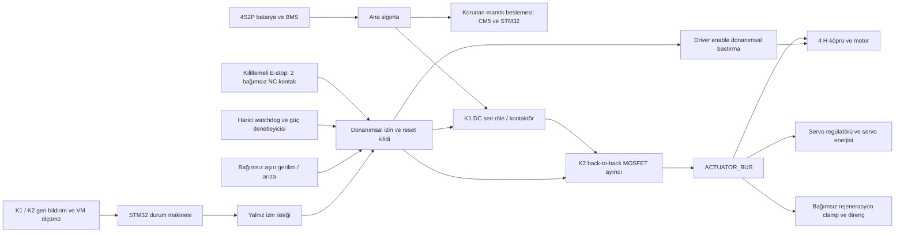

# UGV-01 — Güvenlik ve hata yönetimi mimarisi

Revizyon A / 2026-09-22. Durum: **ön mühendislik taslağı; donanım ve yazılım henüz doğrulanmadı.** Bu belge güvenlik sertifikası veya PL/SIL iddiası değildir. Süreler ve eşikler tasarım hedefleridir, ölçülmüş performans değildir.

## 1. Çalışma sınırı ve güvenli durum

V1 gözetimli Ar-Ge aracıdır. Brüt kütle bütçesi 8 kg, başlangıç hız sınırı 0,8 m/s, teker çapı 120 mm, iz genişliği 240 mm ve dingil mesafesi 210 mm'dir. İlk hareket testleri düz, çevrilmiş alanda yapılır. 15° eğim hedefi tahrik tasarımına aittir; enerji kesildikten sonra eğimde durabilme özelliği anlamına gelmez.

**Elektriksel güvenli durum:** motor PWM/enable pasif; H-köprüleri high-impedance/coast; motor ve servo beslemeleri iki seri ayırıcı üzerinden kesilmiş; yeniden hareket kilitli. CM5, STM32, kayıt ve haberleşme mümkünse beslenir. Kritik batarya arızasında bütün enerji kesilebilir. Coast tekerlekleri kilitlemez; araç ilerleyebilir veya eğimde geriye kayabilir. Testte bağımsız emniyet halatı, fiziksel durdurucular ve takozlar kullanılır. Sahipsiz eğim çalışması, yokuşta park veya ölçülmüş durma alanı dışında sürüş V1 kapsamında değildir.

Normal operatör duruşunda, sağlıklı sensör ve güç hattı varken hız hedefi sınırlı ivmeyle sıfıra iner; sıfır komut motoru yüksek empedansa alır. Bu aktif tutma freni sağlamaz. E-stop, watchdog, hard fault ve komut zaman aşımında rampanın tamamlanması beklenmez: sürüş enerjisi kesilir. Frenleme/ters tork ancak rejenerasyon ve termal testlerden sonra ayrı özellik olarak etkinleştirilir.

Eğimde E-stop sonrası yaklaşık `8 kg × 9,81 m/s² × sin(15°) ≈ 20,3 N` yerçekimi bileşeni aracı geri kaydırabilir. DRV8874'ün `11` düşük taraf freni E-stop için seçilmedi: motor akımı sönümü, batarya ayırma anı ve sürücü enerjisinin sürekliliği doğrulanmadığından bunu garantili tutma freni sayamayız. V1 eğim testinde ankraja bağlı bağımsız halat, fiziksel durdurucu ve takoz zorunlu; sahipsiz eğim görevi yasaktır. Ölçülmüş park/tutma gerekiyorsa normalde kapalı mekanik fren ayrı gereksinimdir.

## 2. Fiziksel güvenlik katmanı

- E-stop dışarıdan erişilen mekanik kilitlemeli mantar butondur. İki NC kontak ayrı yönlendirilir; açık kablo, çıkmış konnektör veya güvenlik mantığı besleme kaybı enerjiyi keser. NC açıkken yazılım hareket iznini zorlayamaz. Kanallar arası kısa devre tespiti şematik incelemede kanıtlanır; iki NC kablo tek başına çapraz kısa devreyi tespit etmez.
- K1 ve K2 ayrı seri kesme yollarıdır. K1 DC kesme kapasitesi, bobin gerilimi ve bırakma süresi gerçek yük için seçilir. K2 iki yönlü akım engelleyen back-to-back yapıdır; tek MOSFET gövde diyodu enerji ayırma işlevini karşılamaz. Bobin korumasının açma gecikmesi ölçülür.
- İki yol E-stop, harici watchdog ve donanımsal izne bağlıdır. STM32 bunları zorla açık tutamaz. K1 kaynaklı kalırsa K2; K2 kısa devre kalırsa K1 motor ve servo enerjisini keser. Ortak besleme/gate sürücü/konektör arızaları ayrıca incelenir.
- K1 kontak geri bildirimi ve K2 bağımsız tanılaması gerekir. Yalnız son motor hattı gerilimi iki seri ayırıcıdan hangisinin kaynaklı kaldığını kanıtlamaz. [MID/ACT akım sınırlı tanı ve ön şarj sırası](precharge_and_separator_diagnostics.md) PH6 işlev tasarımıdır; test kaynağı, üç gerilim ölçümü, 470 Ω K2 bypass, bleed ve donanım gate zinciri tam şematikte belirlenir. K1 boş 4700 µF bulk'a doğrudan kapatılmaz. Kaynaklı kontak tespiti doğrulanmadan ARMED izni verilmez.
- Driver enable/sleep donanımsal pasif kutuplanır. Reset, bootloader, SWD, brownout ve GPIO yüksek empedans durumunda motor çalışmaz. Servo sinyalinden besleme geri akışı engellenir; yalnız PWM sıfırlamak enerji kesme değildir.
- Harici watchdog MCU işlemcisinden bağımsız sürüş iznini keser; kendi besleme kaybı da izni düşürür. STM32 IWDG ikinci katmandır. Watchdog yalnız ana güvenlik çevrimi kontrol, zamanlama, ADC, encoder ve CAN sağlığını doğruladığında beslenir. Timer ISR/DMA'nın sonsuza kadar darbe üretmesi kabul edilmez. Debug watchdog dondurması varsa aktüatör enerjisi fiziksel olarak kesilir. [TPS3431 zamanlama ve fail-safe pin kararı](watchdog_design.md) güç kartı şematik girdisidir.
- Butonu bırakmak, enerji veya CAN geri gelmesi ve CM5 yeniden başlaması hareket başlatmaz. Yerel manuel reset, sağlıklı kontroller, nötr komut ve ayrı arm gerekir. Acil durdurma sıfırlamasının otomatik yeniden başlatmaya yol açmaması [Pilz üretici rehberinde](https://www.pilz.com/en-US/support/faq/standards/articles/180045) açıklanır; bu taslakta sertifikasyon iddia edilmez.

## 3. Enerji kesme, rejenerasyon ve gerçek durma

Besleme ayrıldığında dönen teker motoru jeneratör olabilir. Kesicilerin motor tarafında bulk kapasitör ve bağımsız dump/clamp bulunur; batarya BMS'i açılmışken de çalışır. TVS sürekli rejenerasyon enerjisinin alıcısı değildir. 8 kg / 0,8 m/s doğrusal kinetik enerji 2,56 J; teker/motor dönme enerjisi ve olay tekrarları eklenir. 15° eğimde 0,8 m/s iniş yaklaşık 16,2 W yerçekimi gücü üretir. Birkaç joulelik kapasitör hesabı sürekli iniş yeterliliği göstermez.

Ön öneri: motor tarafında 17,8 V clamp, 18,5 V donanımsal aşırı gerilim kilidi. Parça toleransları, 16,8 V batarya, kablo endüktansı, dump gücü ve en düşük gerilim dayanımlı bileşen doğrulanmadan serbest bırakılmaz. High-impedance durumunda gövde diyodu yolları da incelenir. Bulk ihtiyacının geri verilen akım ve frenlemeye bağlılığı [TI DRV8874 veri sayfasında](https://www.ti.com/lit/ds/symlink/drv8874.pdf) açıklanır; nihai kapasite sistem testiyle belirlenir.

| Olay | Ön kabul hedefi / ölçüm noktası |
|---|---|
| E-stop NC açılması | Kontak açılmasından driver enable pasife ≤2 ms; bataryadan motor ve servo alanına enerji kaynağı ayrılmasına ≤50 ms |
| Komut kaybı | Son taze komuttan timeout'a ≤100 ms; tespit sonrası enable pasif ≤2 ms, kaynak ayırma ≤50 ms |
| Harici watchdog | Son sağlıklı darbeden trip'e worst-case tolerans dahil ≤100 ms; trip sonrası kaynak ayırma ≤50 ms; toplam ≤150 ms |
| MCU IWDG | Hedef ≤100 ms, LSI toleransı dahil; harici ayırma ayrıca çalışır |
| Hard current/voltage fault | Bağımsız comparator/driver koruması; gerçek yayılım + kesme süresi kaydedilir |

Bunlar teker durma süreleri değildir. Akım probu/güç analizörüyle bataryadan ileri enerji aktarımı, diferansiyel probla enable ve motor uçları, encoder/video ile hareket aynı zaman tabanında kaydedilir. Sıfır PWM, sıfır bus gerilimi veya sıfır net batarya akımı tek başına sıfır tork kanıtı değildir. Bağımsız kesicilerin kaynak bağlantısını kestiği, güç sürme darbelerinin bittiği ve motor akımının ölçülen endüktif/regen davranışla sönümlendiği birlikte gösterilir. Durma mesafesi/süresi zemin, yük, hız, eğim ve batarya durumuna göre ölçülür; çalışma alanı ölçümden sonra belirlenir.

## 4. Durum makinesi ve yeniden kurma

Geçişler MCU monotonic saatinde kaydedilir. E-stop ve hard fault en yüksek önceliklidir. BOOT, SELF_TEST, IDLE, **ARMING**, FAULT ve EMERGENCY_STOP'ta hareket izni kapalıdır. ARMING, birkaç saniyelik ön şarjı sürüş izninden ayrı tutar.

| Kaynak → hedef | Koşul / olay | Eylem |
|---|---|---|
| Reset → BOOT | Power-on, brownout, IWDG veya yazılım reseti | GPIO pasif; arm/session/kuyruk sil; reset nedeni kaydet |
| BOOT → SELF_TEST | Saat, bellek/firmware bütünlüğü, besleme, watchdog geçerli | Aktüatör enerjisiz; sense ve feedback test |
| SELF_TEST → IDLE | ADC, encoder, sıcaklık, CAN, kesici tanılama, E-stop ve zorunlu sensörler sağlıklı | Otomatik arm yok |
| SELF_TEST → FAULT | Zorunlu test hatası / 5 s taslak timeout | Hata kilitli, enerji kesik |
| IDLE → ARMING | Gerekli yerel reset yapılmış; ayrı yetkili arm; yeni session; 500 ms nötr; taze deadman; inhibit yok | PWM `00`, nSLEEP ve servo Low; K1/K2 iletimsiz; [boşalma, test ve ön şarj sırası](precharge_and_separator_diagnostics.md) başlar |
| ARMING → ARMED | Ön test ve K1→ön şarj→K2 sırası geçti, K1/K2 tanısı teyit; komut/deadman hâlâ taze; ≤15 s taslak toplam bütçe | Ön şarj/test kapat; `PWR_ACT_EN` ancak şimdi High; PID integratörü sıfır, motor hedefi sıfır |
| ARMING → FAULT | Tanı/ön şarj/iletişim/süre hatası | nSLEEP Low, K1/K2 ayır, hata kilitle |
| ARMED → DRIVING | Yeni sıra numaralı, geçerli süreli, sınırlar içinde sıfır dışı komut + deadman | İvme/akım sınırlı sürüş |
| DRIVING → ARMED | Taze nötr + dört hız 200 ms boyunca mutlak <0,02 m/s | Hedef/integratör sıfır, coast |
| ARMING / ARMED / DRIVING → IDLE | Disarm ve sağlıklı normal duruş tamam | Enerji ayır; arm kaldır |
| ARMING / ARMED / DRIVING → FAULT | Komut/heartbeat timeout, bus-off veya kritik hata | Rampa beklemeden inhibit+ayır; session sonlandır |
| Her durum → EMERGENCY_STOP | NC açılması veya kanal tutarsızlığı | Donanım keser; yazılım kaydeder |
| EMERGENCY_STOP → SELF_TEST | Fiziksel bırakma + kanallar 500 ms sağlıklı + tehlike giderilmiş + yerel reset | Hata kaydını koru; arm olmadan test |
| FAULT → SELF_TEST | Sebep/histerezis giderilmiş + gerekli servis + yerel reset | Yeni session; test sonunda yalnız IDLE |

ARMED sıfır hedefli fakat motor enerjili durumdur; servis durumu değildir. Serviste batarya konnektörü ayrılır, kondansatör gerilimi ölçülür ve takoz uygulanır. E-stop bakım izolasyonu yerine geçmez.

Nötr: dört teker hedefi mutlak ≤0,01 m/s ve pan/tilt isteği yok. Joystick hareketliyken arm reddedilir. Sayfa yenilenmesi, gamepad veya sürüş modu değişimi ve saat sıçraması nötr+arm gerektirir. IWDG dönüşü otomatik devam değildir. G474 iç watchdog/encoder/FDCAN kaynakları [ST ürün sayfasında](https://www.st.com/en/microcontrollers-microprocessors/stm32g474pc.html), LSI'den çalışan IWDG [ST watchdog rehberinde](https://wiki.st.com/stm32mcu/wiki/Getting_started_with_WDG) açıklanır.

## 5. Komut tazeliği ve ağ sınırı

- UI → CM5 başlangıç 50 Hz; joystick/gamepad deadman tutulur. Sekme görünmezliği, odak kaybı, gamepad ayrılması veya bağlantı kaybı arm'ı düşürür. Ekrandaki buton **yazılımsal stop** olarak etiketlenir, fiziksel E-stop eşdeğeri gösterilmez.
- Gateway eski joystick konumunu yeni sayaçla sonsuza kadar yayınlayamaz. Son gerçek operatör paketinin yaşı ve artan kaynak sayacı izlenir; kaynak yaşı ≤100 ms. Yalnız en son paket tutulur; toplu yeniden oynatma yapılmaz.
- CM5 → STM32: 50–100 Hz komut, 50 Hz sağlık heartbeat. Komut veya heartbeat yaşı ≥100 ms FAULT'tur. Heartbeat eski komutun ömrünü uzatmaz; komut sağlık heartbeat gerekliliğini kaldırmaz.
- Paket sözleşmesi: sürüm, session/boot kimliği, artan sequence, komut ömrü, mod, arm ve deadman. Session yalnız IDLE'da yenilenir. Duplicate/out-of-order süreyi yenilemez. Sayaç taşması modulo kıyaslanır; reboot yeni session ister. Sınır dışı, NaN/infinite değer reddedilir.
- CAN CRC kimlik doğrulama sağlamaz; CAN fiziksel araç içi sınırdır. Açık expansion soketine yabancı düğüm eklenmesi tehdit modeline dahildir.
- UI saati MCU saatinden doğrudan çıkarılmaz. Gateway başlangıçta/periyodik monotonic ofset ve RTT belirsizliğini sınırlar; kaynak yaşı+belirsizlik >100 ms ise reddeder. Yeniden bağlantıda buffered WebSocket komutları oynatılmaz. Bu sözleşme uygulanmadan gecikmiş trafik güvenliği tamamlanmış değildir.
- Gateway kabul ettiği komutu yalnız geçerli ömürde iletir; MCU alımdan en çok100 ms yerel lease uygular. Uçtan uca kaynak kaybından elektriksel kesmeye hedef ≤250 ms: kaynak yaşına100 ms, MCU lease'e100 ms, kesiciye50 ms. Ayrıca ölçülür; “ağ kopunca100 ms'de fiziksel duruş” iddia edilmez.
- Araç ağına sınırlı, kimliği doğrulanmış tek sürüş sahibi; diğer istemciler salt telemetri izler. Ağ kapalıyken UI stop komutu “uygulandı” göstermez.

## 6. Ön hata matrisi

Eşikler **P: provisional**; şematik/bench onayı bekler. Hücre eşikleri gerçek BMS ölçümünden gelir; toplam paket voltajı hücre dengesizliğini tespit etmez. Motor adayı Pololu70:1 #4754,12 V/5,5 A stall. Sürekli1,3 A ve transient2,5 A/250 ms henüz doğrulanmış motor sürekli sınırları değildir.

| ID / hata | Algılama, eşik, debounce (P) | Yazılım / fiziksel eylem | Recovery | Test |
|---|---|---|---|---|
| F01 E-stop / açık kablo | Herhangi NC açık; kesmede yazılım debounce yok | K1/K2+enable kes; EMERGENCY_STOP; servo off | Bırak,500 ms sağlıklı,yerel reset,test,nötr+arm | T13 |
| F02 Kanal uyuşmazlığı | Tutarsız kanallar / donanım test fail | E-stop kilidi,izin yok | Kablo/anahtar servisi | T13 |
| F03 K1 kaynaklı / K2 kısa | Feedback uyuşmazlığı >50 ms / enerjisiz test fail | Diğer yol keser,FAULT,driver inhibit | Parça değişimi+iki tek-hata testi | T01/T13 |
| F04 Komut kaybı / replay | Taze komut yaşı ≥100 ms; duplicate yenilemez | FAULT,enable≤2 ms sonra kaynak kesme≤50 ms | Yeni session,yerel reset,nötr+arm | T04/T14 |
| F05 Bus-off / heartbeat kaybı | Bus-off anında / sağlık yaşı≥100 ms | F04; otomatik bus recovery hareket başlatmaz | Hattı düzelt,test,manuel arm | T04/T14 |
| F06 UI/gateway/CM5 arızası | Kaynak yaşı>100 ms,deadman/odak/bağlantı kaybı | CM5 disarm; ulaşmazsa MCU lease keser | Yeni session,nötr+arm;fault ise yerel reset | T10/T14 |
| F07 MCU hang / deadline | Harici WD worst-case≤100 ms; iki ardışık1 ms deadline kaçırma | Harici inhibit,IWDG reset,BOOT hata kaydı | Test,yerel reset;tekrarda servis | T03/T13/T14 |
| F08 Peak / kısa devre | HW cycle-limit nominal2,7 A,tolerans dahil≤3 A;driverOCP | Limit bağımsız;OCP/nFAULT FAULT;sigorta kablo koruması | Arızayı gider,kablo/driver kontrol,reset | T05/T08 |
| F09 Termal yük / stall | 1 s RMS>1,3 A:derate;>2,5 A250 ms veya hedef>0,1m/s+hız<0,02m/s+akım>1,3 A300 ms:FAULT | Derate;kalıcı durumda dört motor kes | Engel gider,soğuma,yerel reset | T08/T11/T12 |
| F10 Düşük hücre | <3,4 V5 s:derate;<3,2 V1 s:normal stop isteği,max500 ms sonra inhibit;<3 V10 ms:hard trip | Yeni arm engeli;kritikte hemen kes;log/CM5 kapanma mümkünse;BMS bağımsız | Dinlenmiş hücre>3,5 V,dengeli,şarj/servis,reset | T15 |
| F11 Aşırı hücre V / dengesizlik | Üretici hücre sınırı/BMS koruması;denge>100 mV10 s warn,>200 mV arm inhibit | Şarj/arm engeli;kritikte BMS ayırır | Hücre/BMS incelemesi | T15 |
| F12 VM aşırı gerilim | Clamp17,8 V,HW latch18,5 V aday;comparator hızlı | Dump bağımsız,enerji kes,FAULT | Clamp/dump/BMS yolu kontrol,reset | T02/T05/T13/T15 |
| F13 Motor/driver ısısı | Motorcase60°C/driverPCB70°C derate1 s;case70°C/PCB85°C stop100 ms | Derate,sonra inhibit;TSD bağımsız yedek | Derate eşiğinin10°C altı30 s+reset | T11/T12 |
| F14 Batarya ısısı | Deşarj45°C derate,55°C stop100 ms;şarj üretici sıcaklık aralığında | Kes;kritik BMS tüm paketi ayırır;sıcak paket şarj olmaz | Soğuma,hücre/bağlantı incelemesi | T12/T15 |
| F15 MCU/CM5 ısısı | STM32 85°C derate,95°C stop100 ms;CM5 OS throttle/heartbeat | MCU kritikte inhibit;CM5 yük/hız düşür,süreç kaybında lease kes | Soğuma/hava yolu kontrol,reset | T12/T14 |
| F16 Encoder arızası | Geçersiz A/B,donmuş count,işaret hatası;>0,1m/s talepte100 ms feedback yok | Kör kapalı çevrim sürüş yok;tüm motor kes | Encoder/kablo test,reset | T06/T08 |
| F17 ADC/sensör arızası | Rail-stuck,kopuk/kısa,sınır dışı;güvenlik örneği≥10 ms eski | FAULT;HW limit etkin | Onarım,kalibrasyon,reset | T02/T05/T12/T15 |
| F18 IMU arızası | Veri>50 ms eski,bus/self-test fail | Stop;özerklik off. Degraded bench modu yalnız IDLE'da açık seçim,≤0,2m/s,düz zemin | IMU1 s sağlıklı,test/reset | T07/T17 |
| F19 Kamera/LiDAR/localization | Video>500 ms eski;özerklik algısı>200 ms eski/localization geçersiz | Kameralı sürüş stop;özerklik disarm;görüş hattı modu yalnız IDLE'da seçilir | Sensör sağlıklı,ayrı arm | T18/T19/T20 |
| F20 Firmware/brownout/config | HardFault/assert/CRC/clock/reset;aralık dışı kalibrasyon | İzin düşer,BOOT,fault latch;varsayılan kalibrasyonla sürüş yok | Firmware/config onar,test,reset | T01/T03/T14 |
| F21 Tilt/sıkışma | Roll veya pitch mutlak>20°100 ms;upright değilken arm yok | FAULT+coast;devrilmeyi geri alamaz;sıkışmadaF09 | Enerjisiz fiziksel düzelt,muayene,reset | T07/T11/T16 |
| F22 Kayıt/telemetri kaybı | Disk dolu,kayıt hatası,sayaç kaybı | Uyarı;MCU koruması sürer;operasyon telemetri gerektiriyorsa disarm | Kayıp açık gösterilir,bağlantı/disk düzelt | T10/T17 |

Driver PCB sıcaklığı junction, motor case sıcaklığı sargı sıcaklığı değildir. Eşiklerin korumaya yeterliliği termal empedans, çevre, yerleşim ve yük testine bağlıdır. Eğim veya pivotta1,3 A sürekli hedef aşılırsa hız/taşıma azaltılır veya drivetrain revize edilir; eşik sessizce yükseltilmez.

## 7. Açık işler ve kapatma

K1/K2 kesin parçalar/DC açma; çift-kanal kısa-devre tanılaması; akım limit toleransı; dump enerji/ısı; BMS hücre arayüzü; sıcaklık korelasyonu; pin/timer planı; kaynak yaşı protokolü; gerçek durma alanı tamamlanmadan üretim/saha serbestliği verilmez.

T01–T09 bench, ardından T13 E-stop ve T14 iletişim kaybı **zemin sürüşünden önce** geçer. [20 test prosedürü](test_plan.md) firmware hash, PCB/CAD revizyonu, batarya kimliği, ortam ve kalibrasyonla kaydedilir. E-stop, kopuk kablo, tek kaynaklı kesici, MCU hang veya otomatik yeniden başlama testleri başarısızsa sonraki hareket aşaması açılmaz.
