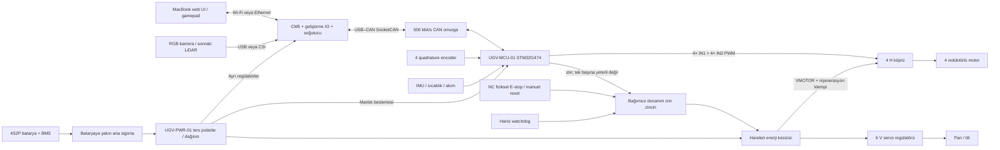

# Sistem mimarisi ve alt sistemler

Rev A0 · Ön tasarım. Mekanik koordinat: x ileri,y sol,z yukarı; z=0 nominal zemin,orijin dingillerin ortasının zemin izdüşümü. Geometri mm,ROS m.

Mermaid kaynak ayrıca `system_block_diagram.mmd` dosyasındadır. Oklar işlevsel bağlantıdır; sürücü transistörleri/koruma elemanları tamamlanmış şema değildir.

| Alt sistem | Sınır / sorumluluk | Değişim / servis |
|---|---|---|
| CHASSIS | 6061 alt plaka,metal travers/motor/rulman yük yolu | Dış muhafazadan bağımsız datum |
| DRIVETRAIN-L/R | İkişer motor,encoder,ayrı destekli göbek,teker | Sağ/sol kartuş;fişler etiketli |
| BODY-F/C/R | Ön sensör,orta elektronik,arka batarya kapları | Üç adet100mm boy segment |
| COMPUTE | CM5,IO,SSD gereksinirse,fan,ağ | Üst servis rafı,USB-C servis erişimi |
| CONTROL | MCU,IMU,enkoder,hız döngüsü,diagnostics | Alt orta sağ bölge |
| MOTOR POWER | H köprüler,VMOTOR dağıtımı,klemp,akım | Alt orta;motor kabloları yan kanallarda |
| BATTERY | Paket,BMS,ana sigorta,mekanik tutucu | Arka üst çekme/servis kapağı |
| SENSOR | RGB,kule,sonraki LiDAR/GNSS | Dört M4 ve anahtarlanmış elektrik arayüzü |
| COMMUNICATION | CAN,USB–CAN,Wi-Fi/Ethernet | Anten motor demetinden uzakta,radom altında |
| SAFETY | Fiziksel NC zincir,harici watchdog,kilitli izin | Linux'tan bağımsız;iki kanallı tasarım değerlendirmesi |
| SOFTWARE | Firmware,ROS2,kayıt,web,otonomi | Hareket yetkisi tek noktadan arbitre edilir |

## CM5 taşıyıcı geçişi

V1: resmi160×90mm CM5 IO kartı,8GB CM5,eMMC,aktif soğutma; USB–CAN üzerinden Linux SocketCAN. Geliştirme kartı hazır robot kiti değildir. Kart etrafında konektör ve kablo bükülme zarfı ayrılır;160×90 tek başına yerleşim ölçüsü sayılmaz. UGV-COMPUTE-01, V1 hareket/kamera/telemetri testleri geçtikten sonra geliştirilir; aynı5V güç ve CAN mantıksal arayüz korunur.

CM5'in yerleşik CAN denetleyicisi yoktur; yalnız transceiver bağlamak çözüm değildir. Gelecek carrier'da SPI CAN denetleyicisi+transceiver veya USB CAN uygulanır. Ethernet/USB3/CSI/PCIe,M.2,power sequence,empedans ve hat eşleme üretici referans tasarımıyla ayrı fazda doğrulanır.

## V1 / gelişim sürümleri

V1 manuel sürüş,RGB,kayıt ve fiziksel güvenlik. V2 algılama önerileri üreten AI node'ları; V3 LiDAR+SLAM+localization; V4 Nav2+engel kaçınma; V5 doğal dilden görev tanımı. Dil modeli hız/PWM mesajı gönderemez: görev→planlayıcı→geçerleme→hareket arbiter→MCU sınırları zincirinden geçer. Her sürüm için güvenlik testleri yeniden çalışır.

Kaynak: [Raspberry Pi CM5 IO](https://www.raspberrypi.com/products/compute-module-5-io-board/) boyut ve arayüz; [Compute Module donanım belgeleri](https://www.raspberrypi.com/documentation/computers/compute-module.html) besleme/carrier yaklaşımı. Erişim22.09.2026.
